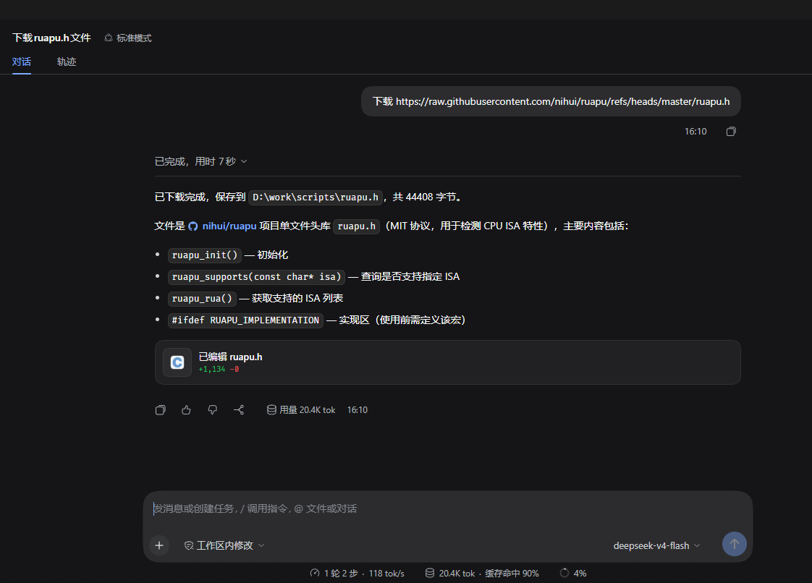
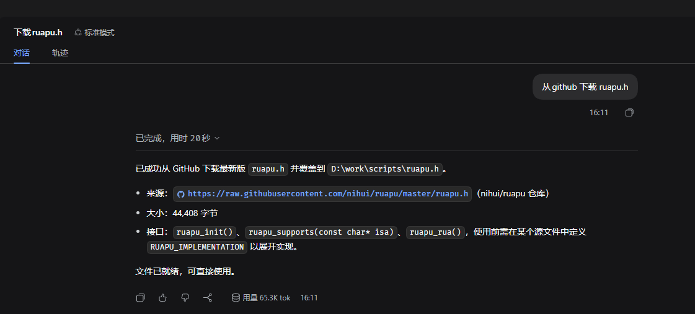
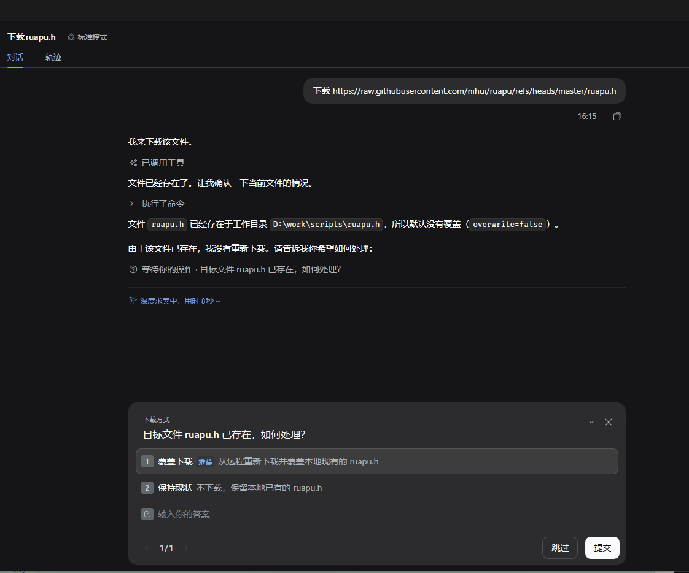

# dsh-download-file

**English | [中文](README.md)**

A DSH plugin that gives your Agent a **`download_file`** tool: download a file from any URL (intranet GitLab, public GitHub, etc.) to local disk — text or binary — and it shows you the first few lines of the file afterward. Pure ESM, zero dependencies, no build step, cross-platform (Windows / Linux / macOS).

## Purpose

One day I opened a fresh DSH (0.2.1-rc2) conversation:

> 下载 https://raw.githubusercontent.com/nihui/ruapu/refs/heads/master/ruapu.h

DSH replied: `Error: spawn EPERM`.

I reopened a session and enabled "full permissions" for the working directory.

DSH said: `ruapu 是 nihui 的项目，我直接尝试下载。`

Two minutes passed and it still hadn't finished downloading. Frustrating.

That's why this plugin exists — **no full working-directory permissions needed, download done within 5 seconds**.

## Install

Command line:

```sh
# profile is usually `desktop` or `web` — see the subdirectories under ~/.dsh/profiles

# install from a local directory
dsh plugin --profile <profile> add file:./dsh-download-file

# or, after publishing to npm, install by package name
dsh plugin --profile <profile> add dsh-download-file
```

GUI: DSH desktop → Plugins → search `dsh-download-file`.

---

## Usage examples

### In a chat

Giving the exact URL is the fastest:

```
下载 https://raw.githubusercontent.com/nihui/ruapu/refs/heads/master/ruapu.h
```



Binary files work too:

```
下载 https://github.com/nihui/vkpeak/releases/download/20260527/vkpeak-20260527-windows.zip
```

A rough description also works — DSH will call the search API automatically, though it can be a bit slower:

```
下载 github 上的 ruapu.h
```



If the file already exists, it is detected and DSH asks whether to overwrite:



### In SKILL.md

A real skill example — install asan.cmake, located at `C:/users/xxx/.dsh/skills/install-asan-cmake/SKILL.md`:

```md
---
name: install-asan-cmake
description: Download and install asan.cmake to the given directory (default: current dir); if the target exists, ask before updating.
---

# Install asan.cmake

Source: `https://raw.githubusercontent.com/zchrissirhcz/rocbuild/refs/heads/main/plugins/asan.cmake`

## Steps

1. **Target directory**: use the user-specified one, otherwise the current directory (created if missing).
2. **Already exists?**: each run, first use `read`/`glob` to actually check the disk for an existing `asan.cmake` (never judge from conversation history). Only ask about updating if it exists; "no" → skip and state nothing changed, "yes" → overwrite.
3. **Download**: use `download_file`, `url` = the source, `save_path` = absolute path to `asan.cmake` under the target directory. The byte count returned by `download_file` is the verification; don't re-read the file.

## Notes

- Save the content verbatim, no processing.
- On failure, explain why; don't write empty files.
- Don't overwrite existing files without confirmation.
- Keep tool-call rounds low: every extra round costs one more LLM round trip.
```

---

## Parameters

`download_file(url, save_path?, overwrite?)`

| Parameter | Required | Description |
|---|---|---|
| `url` | yes | Full file URL (any http/https: intranet GitLab raw, public GitHub, etc.) |
| `save_path` | no | Omitted → current working directory (filename taken from the URL); ending in `/` or pointing to an existing directory → treated as a directory; otherwise → treated as a full file path (parent dirs auto-created) |
| `overwrite` | no | When the target already exists: `false` (default) → skip, do not overwrite; `true` → overwrite |

> Note: when the URL has no trailing filename (e.g. `https://x/`), it falls back to `download-<timestamp>` as the filename to avoid collisions.

---

## What the result contains

**Successful download**:

```json
{ "ok": true, "url": "...", "saved_to": "E:\\proj\\configs\\xxxbuild.cmake",
  "bytes": 2048, "binary": false, "preview": "cmake_minimum_required(VERSION 3.16)\nproject(example)" }
```

- `saved_to`: absolute path of the saved file.
- `bytes`: size in bytes.
- `binary`: `false` means text; `true` means binary (images, archives, etc.).
- `preview`: first few lines of the file, useful to confirm the content; for binary files it is a notice string.

**File already exists and was not overwritten**:

```json
{ "ok": true, "skipped": true, "exists": true,
  "saved_to": "E:\\proj\\configs\\xxxbuild.cmake", "bytes": 2048 }
```

When the model sees `skipped`, it knows nothing was overwritten and will ask whether to force a refresh.

---

## Common scenarios

- **Repeatedly download the same config** → use the default (`overwrite: false`), existing files are kept; add `overwrite: true` to refresh.
- **Download binary files** (installers, images, archives) → supported the same way, `binary: true`, bytes preserved verbatim.
- **Download public files** (GitHub, etc.) → same as GitLab, just pass the URL.

---

## Difference from the built-in web_fetch

| | `download_file` (this plugin) | `web_fetch` (built-in) |
|---|---|---|
| Purpose | **Download as a file**, save to disk | **Read a page**, return the body to the model |
| Content | Raw bytes, binary-friendly | Extracts text, drops binary |
| Result | File path + byte count + text preview | Summarized text |
| Size | Unlimited (streamed) | Limited by context / fetch policy |

In short: want a **file** → `download_file`; want to **read an article** → `web_fetch`.

---

## Other features

- **Disk-based existence check**: whether the target exists is determined from the disk; existing files are not overwritten by default, avoiding silent data loss.
- **Byte-verbatim saving**: text line endings (`\n`/`\r\n`) and binary bytes are never transformed or lost.
- **No size limit**: streamed write, never loads the whole file into memory.
- **120s timeout guard**: a stuck download/write is aborted automatically instead of hanging forever.
- **No approval prompt on write**: writes directly in the host process, no per-operation authorization.
- **Failures use DSH's native `isError`**: network/HTTP errors are returned as tool failures, handled uniformly by the model.

## Tests

```sh
npm test   # equivalent to node --test
```

14 cases cover all of `index.js`: the download core (line endings / binary / large files / three-state `save_path` / disk existence check / filename fallback / timeout abort / empty body) plus the plugin wiring (tool registration, all three `render` branches, `execute`'s cwd resolution and fallback). Line coverage is near 100%.

## License

[MIT](LICENSE)