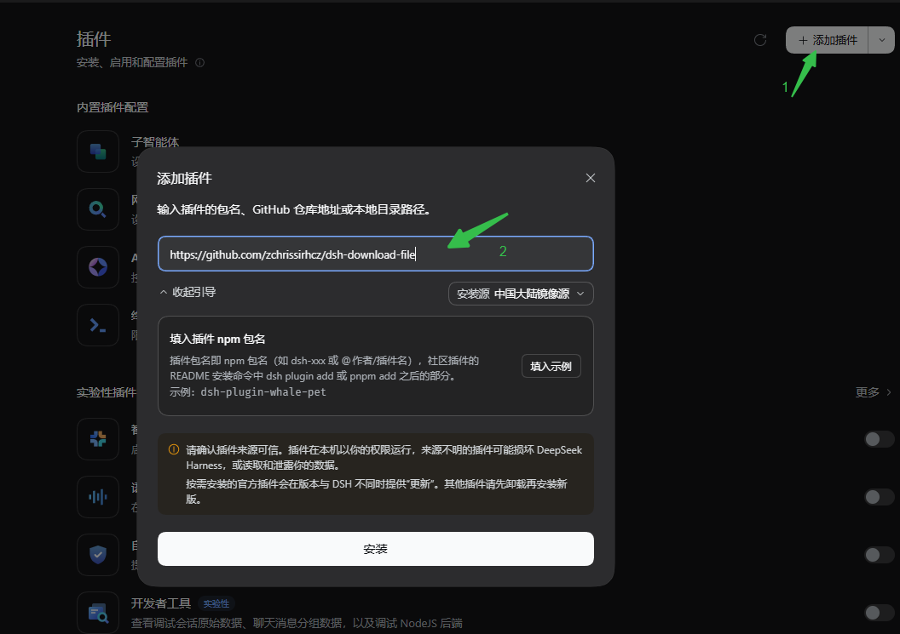

# dsh-download-file

**[English](README.en.md) | 中文**

一个 DSH 插件，给 Agent 加一个 `download_file` 工具：把任意 URL（内网 GitLab、公网 GitHub 等）的文件下载到本地磁盘，文本、二进制都行，下载完还会把文件开头几行预览给你看。纯 ESM、零依赖、无需构建，Windows / Linux / macOS 通用。

## 目的

某天，我打开 DSH（0.2.1-rc2）开了一个全新对话：

> 下载 https://raw.githubusercontent.com/nihui/ruapu/refs/heads/master/ruapu.h

DSH 回了一句：`Error: spawn EPERM`。

我重开一个会话，给工作目录开了「完全权限」。

DSH 说：`ruapu 是 nihui 的项目，我直接尝试下载。`

过了 2 分钟，还没下完。挺捉急的。

所以就有了这个插件——**不需要工作目录的完全权限，5 秒内搞定下载**。

## 安装

命令行方式：

```sh
# profile 通常是 desktop 或 web，见 ~/.dsh/profiles 下的子目录

# 从本地目录安装
dsh plugin --profile <profile> add file:./dsh-download-file

# 或发布到 npm 后按包名安装
dsh plugin --profile <profile> add dsh-download-file
```

GUI 方式：DSH 桌面版 → 插件 → 填入 "https://github.com/zchrissirhcz/dsh-download-file"



---

## 用法举例

### 在会话中

准确的给出 URL， 下载速度是最快的：

```
下载 https://raw.githubusercontent.com/nihui/ruapu/refs/heads/master/ruapu.h
```


也支持二进制文件的下载：

```
下载 https://github.com/nihui/vkpeak/releases/download/20260527/vkpeak-20260527-windows.zip
```

只给个大概描述也行，DSH 会自动调用搜索 API, 不过速度可能稍慢：

```
下载 github 上的 ruapu.h
```


如果文件已经存在，会检测到并询问是否覆盖：


### 在 SKILL.md 中

下面是一个真实可用的 skill 例子: 安装 asan.cmake, 它位于 `C:/users/xxx/.dsh/skills/install-asan-cmake/SKILL.md`

```md
---
name: install-asan-cmake
description: 下载并安装 asan.cmake 到指定目录（默认当前目录），目标已存在时先询问是否更新。
---

# 安装 asan.cmake

下载源：`https://raw.githubusercontent.com/zchrissirhcz/rocbuild/refs/heads/main/plugins/asan.cmake`

## 步骤

1. **目标目录**：用户指定则用之，否则取当前目录（不存在则创建）。
2. **已存在？**：每次执行都先用 `read`/`glob` **实际检查磁盘**目标路径是否已有 `asan.cmake`（**禁止凭对话历史判断**）。存在时才询问是否更新；回答「否」则跳过并说明未改动，回答「是」才覆盖。
3. **下载**：用 `download_file`，`url` 填下载源，`save_path` 填目标目录下的 `asan.cmake`（绝对路径）。`download_file` 返回的字节数即校验结果，**不要再额外读取校验**。

## 注意

- 内容原样落盘，不加工。
- 失败时说明原因，不写空文件。
- 未获确认不覆盖已有文件。
- 尽量减少工具调用轮次：每多一个回合就多一次 LLM 往返耗时。
```

---

## 参数速查

`download_file(url, save_path?, overwrite?)`

| 参数 | 必填 | 说明 |
|---|---|---|
| `url` | 是 | 文件完整 URL（内网 GitLab raw、公网 GitHub 等任意 http/https） |
| `save_path` | 否 | 省略→当前工作目录（文件名取 URL 原始名）；以 `/` 结尾或指向已存在目录→作为目录；否则作为完整文件路径（自动建父目录） |
| `overwrite` | 否 | 文件已存在时：`false`（默认）→ 跳过、不覆盖；`true` → 覆盖 |

> 补充：URL 末尾没有文件名时（如 `https://x/`），会用 `download-<时间戳>` 当文件名，避免重名。

---

## 返回结果里有什么

**成功下载**：

```json
{ "ok": true, "url": "...", "saved_to": "E:\\proj\\configs\\xxxbuild.cmake",
  "bytes": 2048, "binary": false, "preview": "cmake_minimum_required(VERSION 3.16)\nproject(example)" }
```

- `saved_to`：文件实际落盘的绝对路径。
- `bytes`：字节数。
- `binary`：`false` 表示文本；`true` 表示二进制（图片、压缩包等）。
- `preview`：文件开头几行，用来确认内容对不对；二进制时是一句提示。

**文件已存在、默认没覆盖**：

```json
{ "ok": true, "skipped": true, "exists": true,
  "saved_to": "E:\\proj\\configs\\xxxbuild.cmake", "bytes": 2048 }
```

模型看到 `skipped` 就知道没覆盖，会再来问你是否强制刷新。

---

## 常见场景

- **反复下载同一份配置** → 用默认（`overwrite: false`），不会覆盖已有文件；想刷新就加 `overwrite: true`。
- **下载二进制**（安装包、图片、压缩包）→ 同样支持，`binary: true`，字节原样保存。
- **下载公网文件**（GitHub 等）→ 和 GitLab 一样，直接传 URL。

---

## 和内置 web_fetch 的区别

| | `download_file`（本插件） | `web_fetch`（内置） |
|---|---|---|
| 用途 | **下载成文件**，落到磁盘 | **阅读网页**，返回正文给模型 |
| 内容 | 原始字节，二进制友好 | 提取正文，丢弃二进制 |
| 结果 | 文件路径 + 字节数 + 文本预览 | 摘要文本 |
| 大小 | 不限（流式） | 受上下文/抓取策略限制 |

一句话：要「拿回来一个文件」用 `download_file`，要「读一篇文章」用 `web_fetch`。

---

## 其他特性

- **磁盘级存在检查**：目标是否已存在以磁盘为准，默认不覆盖，避免静默覆盖。
- **逐字节原样保存**：文本换行符（`\n`/`\r\n`）、二进制字节均不转换、不丢失。
- **无大小上限**：流式写入，不把整个文件读进内存。
- **120 秒超时保护**：下载/写入卡死时自动中止，不会无限挂起。
- **写盘不弹授权**：在主机进程直接落盘，不需要逐次授权。
- **失败走 DSH 原生 `isError`**：网络/HTTP 错误作为工具失败返回，模型处理统一。

## 测试

```sh
npm test   # 等价于 node --test
```

14 个用例覆盖 `index.js` 的全部逻辑：下载核心（换行 / 二进制 / 大文件 / `save_path` 三态 / 磁盘存在检查 / 文件名回退 / 超时中止 / 空响应体）+ 插件接线（工具注册、`render` 三分支、`execute` 的 cwd 解析与回退），行覆盖接近 100%。

## License

[MIT](LICENSE)